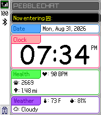

<!-- Generated by scripts/update_app_directory.py: do not edit by hand -->
[← All Pebble Developers](../developers.md)

# Brandon Coupal

*1 watchface · Last updated 2026-10-11 · [About these lists](../about-app-lists.md)*

Links: [Pebble App Store](https://apps.repebble.com/apps/dev/brandon-coupal_0db1e0062a42c30823b3ab72) · [GitHub (bscoup01)](https://github.com/bscoup01)

<h2 class="app-name" id="app-1d034effa03a4d10b41b6556"><a href="https://apps.repebble.com/1d034effa03a4d10b41b6556">PebbleChat</a> v1.0.1</h2>
<a class="app-source" href="https://github.com/bscoup01/PebbleChat" title="Source code" data-search-exclude>View source</a>

Watchface

MIT Released 2026-09-01 Updated 2026-09-02

Runs on: Time 2

A watchface for the Pebble Time 2 inspired by Pictochat on the Nintendo DS!

