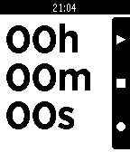

<!-- Generated by scripts/update_app_directory.py: do not edit by hand -->
[← All Pebble Developers](../developers.md)

# Brandon Milton

*1 app · Last updated 2026-10-11 · [About these lists](../about-app-lists.md)*

Links: [Pebble App Store](https://apps.repebble.com/apps/dev/brandon-milton_52d06b4f74a38ec3b500005f) · [GitHub (brandonio21)](https://github.com/brandonio21) · [Website (brandonsoft.com)](http://brandonsoft.com)

<h2 class="app-name" id="app-52e8cb0fa85c6301af000005"><a href="https://apps.repebble.com/52e8cb0fa85c6301af000005">Simple Stopwatch</a> v2.2.5</h2>
<a class="app-source" href="https://github.com/brandonio21/SimpleStopwatch" title="Source code" data-search-exclude>View source</a>

App

MIT Released 2014-01-29 Updated 2014-03-14

Runs on: Time 2, Pebble 2 Duo, Pebble 2, Time, Classic

A simple stopwatch app with a large, clear display and functionality to pause, reset, and lap. Also continues timing when app is closed! -The top button pauses/resumes the stopwatch -The middle…

