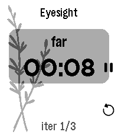

<!-- Generated by scripts/update_app_directory.py: do not edit by hand -->
[← All Pebble Developers](../developers.md)

# Brandon Norick

*1 app · Last updated 2026-10-12 · [About these lists](../about-app-lists.md)*

Links: [Pebble App Store](https://apps.repebble.com/apps/dev/brandon-norick_849e7ff9608d2e1d20f51f93) · [GitHub (bnorick)](https://github.com/bnorick) · [Website (bnorick.github.io)](https://bnorick.github.io/pebble-dev/thymer/guide/getting-started)

<h2 class="app-name" id="app-337bcb025b4e48788aa24d00"><a href="https://apps.repebble.com/337bcb025b4e48788aa24d00">Thymer</a> v1.5.0</h2>
<a class="app-source" href="https://github.com/bnorick/pebble-dev/tree/main/apps/thymer" title="Source code" data-search-exclude>View source</a>

App

No licence Released 2026-07-03 Updated 2026-07-13

Runs on: Time 2

Thymer is a highly configurable timer app specifically tuned for Pebble Time 2: moderately big text for my old eyes, touch controls, and... that&#x27;s it I guess. Timer definitions are written in…

