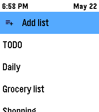

<!-- Generated by scripts/update_app_directory.py: do not edit by hand -->
[← All Pebble Developers](../developers.md)

# breezy

*1 app · Last updated 2026-10-12 · [About these lists](../about-app-lists.md)*

Links: [Pebble App Store](https://apps.repebble.com/apps/dev/breezy_a9ed8f2b80eaaf6c033c87f0) · [GitHub (shan-srini)](https://github.com/shan-srini)

<h2 class="app-name" id="app-da6fc48e443c49ebbc9d5ff0"><a href="https://apps.repebble.com/da6fc48e443c49ebbc9d5ff0">PebbleTasks</a> v1.0.4</h2>
<a class="app-source" href="https://github.com/shan-srini/PebbleTasks" title="Source code" data-search-exclude>View source</a>

App

Released 2026-05-22 Updated 2026-05-23

Runs on: Round 2, Time 2, Pebble 2 Duo, Pebble 2, Time Round, Time

# 📋 PebbleTasks — Google Tasks on your wrist ⌚ Your to-dos, right on your Pebble. 📱➡️⌚ Open lists, tick things off, and stay organised without pulling out your phone. 🎯 --- ## ✨ Getting started…

