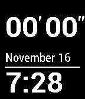

<!-- Generated by scripts/update_app_directory.py: do not edit by hand -->
[← All Pebble Developers](../developers.md)

# Brendan Houle

*1 watchface · Last updated 2026-10-12 · [About these lists](../about-app-lists.md)*

Links: [Pebble App Store](https://apps.repebble.com/apps/dev/brendan-houle_542b8f8e1ba26eb5b1000008) · [GitHub (bhoule)](https://github.com/bhoule)

<h2 class="app-name" id="app-546647ef44c39e5058000079"><a href="https://apps.repebble.com/546647ef44c39e5058000079">Stopwatchface</a> v1.0</h2>
<a class="app-source" href="https://github.com/bhoule/Pebble-Stopwatchface" title="Source code" data-search-exclude>View source</a>

Watchface

No licence Released 2014-11-14 Updated 2014-11-17

Runs on: Time 2, Pebble 2 Duo, Pebble 2, Time, Classic

Counts minutes and seconds from the instant the watchface is selected. The current date and time are displayed below.

