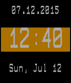

<!-- Generated by scripts/update_app_directory.py: do not edit by hand -->
[← All Pebble Developers](../developers.md)

# Brennan-Macaig

*1 watchface · Last updated 2026-10-11 · [About these lists](../about-app-lists.md)*

Links: [Pebble App Store](https://apps.repebble.com/apps/dev/brennan-macaig_54d03817699bce3234000059) · [GitHub (brennan-macaig)](https://github.com/brennan-macaig)

<h2 class="app-name" id="app-55a280ddc6cca79dd1000022"><a href="https://apps.repebble.com/55a280ddc6cca79dd1000022">Simplicity Time</a> v2.1</h2>
<a class="app-source" href="https://github.com/brennan-macaig/SimpleTime" title="Source code" data-search-exclude>View source</a>

Watchface

No licence Released 2015-07-12 Updated 2015-07-14

Runs on: Time 2, Pebble 2 Duo, Pebble 2, Time, Classic

Simple Time brings simplicity back to a clock. It tells you the time in big, bold lettering, and it also displays today&#x27;s date in two different easy-to-read formats. It also brings some color into…

