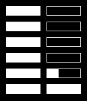

<!-- Generated by scripts/update_app_directory.py: do not edit by hand -->
[← All Pebble Developers](../developers.md)

# Brent Fitzgerald

*1 watchface · Last updated 2026-10-12 · [About these lists](../about-app-lists.md)*

Links: [Pebble App Store](https://apps.repebble.com/apps/dev/brent-fitzgerald_52a94927c0ca93962700001d) · [GitHub (burnto)](https://github.com/burnto)

<h2 class="app-name" id="app-52a94ae079c18ff6e2000024"><a href="https://apps.repebble.com/52a94ae079c18ff6e2000024">Meter</a> v1.0.0</h2>
<a class="app-source" href="https://github.com/burnto/pebble/tree/master/meter" title="Source code" data-search-exclude>View source</a>

Watchface

MIT Released 2013-12-12 Updated 2013-12-12

Runs on: Time 2, Pebble 2 Duo, Pebble 2, Time, Classic

Simple, easy to read at a glance, open source.

