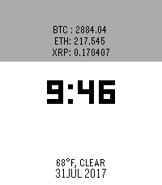

<!-- Generated by scripts/update_app_directory.py: do not edit by hand -->
[← All Pebble Developers](../developers.md)

# bretth18

*1 watchface · Last updated 2026-10-11 · [About these lists](../about-app-lists.md)*

Links: [Rebble App Store](https://apps.rebble.io/en_US/developer/597a17280dfc323bd000052e/1) · [GitHub (bretth18)](https://github.com/bretth18) · [Website (bretth18.me)](http://bretth18.me)

<h2 class="app-name" id="app-597a7e9b461a8dd0c0000584"><a href="https://apps.rebble.io/en_US/application/597a7e9b461a8dd0c0000584">CryptoWatch</a> v1.1</h2>
<a class="app-source" href="https://github.com/bretth18/pebble_cryptowatch" title="Source code" data-search-exclude>View source</a>

Watchface

MIT Released 2017-07-28 Updated 2017-08-01 Rebble App Store

Runs on: Round 2, Time 2, Pebble 2 Duo, Pebble 2, Time Round, Time

A simple digital clock face with USD-&gt;COIN price data for 3 of the top market cap cryptocurrencies. Also includes localized weather data at the bottom!

