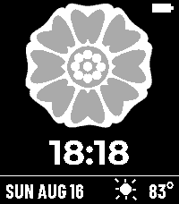
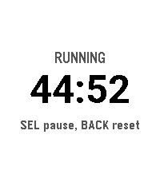
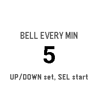

<!-- Generated by scripts/update_app_directory.py: do not edit by hand -->
[← All Pebble Developers](../developers.md)

# Brian Barrow

*1 watchface and 3 apps · Last updated 2026-10-11 · [About these lists](../about-app-lists.md)*

Links: [Pebble App Store](https://apps.repebble.com/apps/dev/brian-barrow_f274760627a9ea167ea488f3) · [GitHub (briancbarrow)](https://github.com/briancbarrow)

<button type="button" data-filter="all" aria-pressed="true">All 4</button><button type="button" data-filter="watchface" aria-pressed="false">Watchfaces 1</button><button type="button" data-filter="watchapp" aria-pressed="false">Apps 3</button>

<label class="dev-sort">Sort by <select><option value="updated">Recently updated</option><option value="released">Newest release</option><option value="title">A–Z</option></select></label>

<h2 class="app-name" id="app-b69c746732c14b8bbc1bbb5a"><a href="https://apps.repebble.com/b69c746732c14b8bbc1bbb5a">White Lotus</a> v1.1.0</h2>
<a class="app-source" href="https://github.com/briancbarrow/lotus-watchface" title="Source code" data-search-exclude>View source</a>

Watchface

No licence Released 2026-08-17 Updated 2026-08-31

Runs on: Time 2

White Lotus symbol watchface from the ATLA universe.

<h2 class="app-name" id="app-c0f875a52eb944f985579524"><a href="https://apps.repebble.com/c0f875a52eb944f985579524">Soccer Timer</a> v0.0.2</h2>
<a class="app-source" href="https://github.com/briancbarrow/ref-timer" title="Source code" data-search-exclude>View source</a>

App

No licence Released 2026-08-15 Updated 2026-08-29

Runs on: Round 2, Time 2

Soccer match timer with vibration alerts at 2 minutes, 30 seconds, and full time. Keeps counting past zero so you can track stoppage time.&quot;

<h2 class="app-name" id="app-62bcf5295724432897c2e7cc"><a href="https://apps.repebble.com/62bcf5295724432897c2e7cc">Ref Match</a> v0.1.0</h2>
<a class="app-source" href="https://github.com/briancbarrow/ref-match" title="Source code" data-search-exclude>View source</a>

App

No licence Released 2026-08-29 Updated 2026-08-29

Runs on: Round 2, Time 2

App to record time, goals, cards as a soccer referee

<h2 class="app-name" id="app-2c08d28f32f4496baa7ce502"><a href="https://apps.repebble.com/2c08d28f32f4496baa7ce502">Meditation Timer</a> v0.0.2</h2>
<a class="app-source" href="https://github.com/briancbarrow/meditation-timer" title="Source code" data-search-exclude>View source</a>

App

No licence Released 2026-08-17 Updated 2026-08-17

Runs on: Round 2, Time 2

A meditation timer with interval bells, entirely on the watch.

