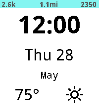
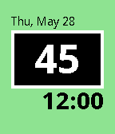
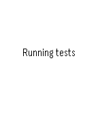

<!-- Generated by scripts/update_app_directory.py: do not edit by hand -->
[← All Pebble Developers](../developers.md)

# Brian Douglass

*2 watchfaces and 1 app · Last updated 2026-10-11 · [About these lists](../about-app-lists.md)*

Links: [Pebble App Store](https://apps.repebble.com/apps/dev/brian-douglass_5385e6abf60aaf4d9f0000c9) · [GitHub (bhdouglass)](https://github.com/bhdouglass) · [Website (bhdouglass.com)](http://bhdouglass.com/pebble/simply-light.html)

<button type="button" data-filter="all" aria-pressed="true">All 3</button><button type="button" data-filter="watchface" aria-pressed="false">Watchfaces 2</button><button type="button" data-filter="watchapp" aria-pressed="false">Apps 1</button>

<label class="dev-sort">Sort by <select><option value="updated">Recently updated</option><option value="released">Newest release</option><option value="title">A–Z</option></select></label>

<h2 class="app-name" id="app-5472c040c13ebf3ddf000045"><a href="https://apps.repebble.com/5472c040c13ebf3ddf000045">Simply Light</a> v6.33</h2>
<a class="app-source" href="https://github.com/bhdouglass/simply-light" title="Source code" data-search-exclude>View source</a>

Watchface · <a href="https://forum.rebble.io/t/880" title="Discuss this app on the Rebble forum" data-search-exclude>Forum thread</a>

GPL-3.0 Released 2014-11-24 Updated 2026-04-15

Runs on: Round 2, Time 2, Pebble 2 Duo, Pebble 2, Time Round, Time, Classic

A simple and highly configurable watchface that is light on your battery. Options include selecting different colors for day and night, weather provider, air quality (aqi) or temperature and many…

<h2 class="app-name" id="app-574537f64b706803bc000002"><a href="https://apps.repebble.com/574537f64b706803bc000002">Hazy</a> v1.10</h2>
<a class="app-source" href="https://github.com/bhdouglass/hazy" title="Source code" data-search-exclude>View source</a>

Watchface

GPL-3.0 Released 2016-05-25 Updated 2016-10-11

Runs on: Round 2, Time 2, Pebble 2 Duo, Pebble 2, Time Round, Time, Classic

Check the air quality (AQI) right from your Pebble smartwatch, wherever you are in the world! Air quality data is provided by aqicn.org. The Hazy watchface and its author are not affiliated with…

<h2 class="app-name" id="app-576619b60cc8f5552100016d"><a href="https://apps.repebble.com/576619b60cc8f5552100016d">JS Compatibility</a> v0.02</h2>
<a class="app-source" href="https://github.com/bhdouglass/pebble-js-compatibility" title="Source code" data-search-exclude>View source</a>

App

No licence Released 2016-06-19 Updated 2016-06-22

Runs on: Round 2, Time 2, Pebble 2 Duo, Pebble 2, Time Round, Time, Classic

A Pebble watch app to test the compatibility of different JavaScript engines. This is being used to test RockWork&#x27;s compatibility with the official Pebble App&#x27;s JavaScript engine. RockWork is an…

