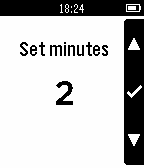

<!-- Generated by scripts/update_app_directory.py: do not edit by hand -->
[← All Pebble Developers](../developers.md)

# Brian Folts

*1 app · Last updated 2026-10-12 · [About these lists](../about-app-lists.md)*

Links: [Pebble App Store](https://apps.repebble.com/apps/dev/brian-folts_55915487612d762e0e000058) · [GitHub (bafolts)](https://github.com/bafolts) · [Website (brianfolts.com)](http://www.brianfolts.com/)

<h2 class="app-name" id="app-559726f570f2c3e22500008f"><a href="https://apps.repebble.com/559726f570f2c3e22500008f">Interval Timer</a> v1.0</h2>
<a class="app-source" href="https://github.com/bafolts/pebble-interval-timer" title="Source code" data-search-exclude>View source</a>

App

No licence Released 2015-07-04 Updated 2015-07-04

Runs on: Time 2, Pebble 2 Duo, Pebble 2, Time, Classic

Interval timer app. Useful for when doing intervals. Upon completion of an interval the watch will vibrate to indicate the start of the next interval. The interval can be paused or restarted at…

