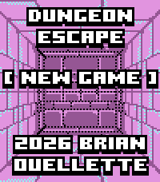

<!-- Generated by scripts/update_app_directory.py: do not edit by hand -->
[← All Pebble Developers](../developers.md)

# Brian Ouellette

*3 apps · Last updated 2026-10-12 · [About these lists](../about-app-lists.md)*

Links: [Pebble App Store](https://apps.repebble.com/apps/dev/brian-ouellette_56663a467da16add50000063) · [GitHub (BrianEnders)](https://github.com/BrianEnders)

<button type="button" data-filter="all" aria-pressed="true">All 3</button><button type="button" data-filter="watchface" aria-pressed="false" disabled>Watchfaces 0</button><button type="button" data-filter="watchapp" aria-pressed="false">Apps 3</button>

<label class="dev-sort">Sort by <select><option value="updated">Recently updated</option><option value="released">Newest release</option><option value="title">A–Z</option></select></label>

<h2 class="app-name" id="app-4c0e0a3919a74fdf85cf11ab"><a href="https://apps.repebble.com/4c0e0a3919a74fdf85cf11ab">Timer+ Touch</a> v4.5.0</h2>
<a class="app-source" href="https://github.com/BrianEnders/pebble-timer-plus-touch" title="Source code" data-search-exclude>View source</a>

App

MIT Released 2026-06-28 Updated 2026-06-28

Runs on: Round 2, Time 2, Pebble 2 Duo, Pebble 2, Time Round, Time, Classic

Timer+ is a beautifully animated, simple timer and stopwatch for your Pebble! It was created by Ycleptic Studios. It keeps track of your timer even after you close the app and will open the app…

<h2 class="app-name" id="app-4d6fde68a2b047ef83381221"><a href="https://apps.repebble.com/4d6fde68a2b047ef83381221">Dungeon Escape</a> v0.6.0</h2>
<a class="app-source" href="https://github.com/BrianEnders/Dungeon-Escape" title="Source code" data-search-exclude>View source</a>

App

GPL-3.0 Released 2026-04-29 Updated 2026-05-17

Runs on: Round 2, Time 2

DUNGEON ESCAPE A first-person dungeon crawler RPG built for your wrist. THE STORY You wake in a prison cell with no memory. Accused of a murder you didn&#x27;t commit, your only choice is to escape…

<h2 class="app-name" id="app-5a31b3f40dfc32dba00012d8"><a href="https://apps.repebble.com/5a31b3f40dfc32dba00012d8">Crypto Watch</a> v1.5</h2>
<a class="app-source" href="https://github.com/BrianEnders/pebble-crypto" title="Source code" data-search-exclude>View source</a>

App

Apache-2.0 Released 2017-12-13 Updated 2017-12-31

Runs on: Round 2, Time 2, Pebble 2 Duo, Pebble 2, Time Round, Time, Classic

Crypto Tracker for Pebble With this app you can watch the price of Bitcoin, Litecoin, Bitcoin Cash, and Ethereum on the Coinbase Market. You will be able to choose your currency type as well. As…

