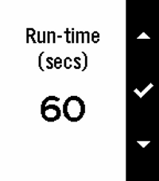
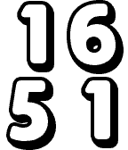
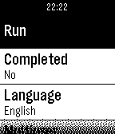
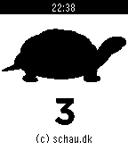
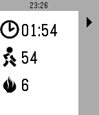
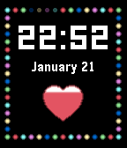
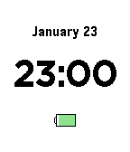
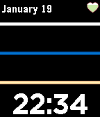
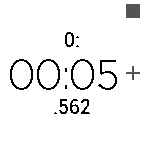

<!-- Generated by scripts/update_app_directory.py: do not edit by hand -->
[← All Pebble Developers](../developers.md)

# Brian Schau

*7 watchfaces and 5 apps · Last updated 2026-10-11 · [About these lists](../about-app-lists.md)*

Links: [Rebble App Store](https://apps.rebble.io/en_US/developer/52bc98fc530bf4ed75000183/1) · [Pebble App Store](https://apps.repebble.com/apps/dev/brian-schau_52bc98fc530bf4ed75000183) · [GitHub (bschau)](https://github.com/bschau) · [Website (schau.dk)](https://www.schau.dk)

<button type="button" data-filter="all" aria-pressed="true">All 12</button><button type="button" data-filter="watchface" aria-pressed="false">Watchfaces 7</button><button type="button" data-filter="watchapp" aria-pressed="false">Apps 5</button>

<label class="dev-sort">Sort by <select><option value="updated">Recently updated</option><option value="released">Newest release</option><option value="title">A–Z</option></select></label>

<h2 class="app-name" id="app-59fa25710dfc323e11002d46"><a href="https://apps.rebble.io/en_US/application/59fa25710dfc323e11002d46">Whip</a> v1.0</h2>
<a class="app-source" href="https://github.com/bschau/Portfolio/tree/main/pebble/Whip" title="Source code" data-search-exclude>View source</a>

App

No licence Released 2017-11-01 Updated 2017-11-01 Rebble App Store

Runs on: Round 2, Time 2, Pebble 2 Duo, Pebble 2, Time Round, Time, Classic

If you need to start running f.ex. to help accelerate a weight-loss, Whip may be just what you need. In Whip you set for how long to run and walk and the number of iterations. F.ex. if run time is…

<h2 class="app-name" id="app-58024684c988665c14000016"><a href="https://apps.repebble.com/58024684c988665c14000016">Big</a> v1.0</h2>
<a class="app-source" href="https://github.com/bschau/Big" title="Source code" data-search-exclude>View source</a>

Watchface

No licence Released 2016-10-15 Updated 2016-10-15

Runs on: Time 2, Time

Big shows the current time in big numbers. Flick the watch to reveal the date and battery status.

<h2 class="app-name" id="app-57c04b28f69d1de23e00015b"><a href="https://apps.repebble.com/57c04b28f69d1de23e00015b">First 5km</a> v2.1</h2>
<a class="app-source" href="https://github.com/bschau/First5km.git" title="Source code" data-search-exclude>View source</a>

App

No licence Released 2016-08-26 Updated 2016-08-26

Runs on: Time 2, Pebble 2 Duo, Pebble 2, Time, Classic

Can you run 5km? With this app you can. The First 5km app can be found in the Pebble AppStore. This app tracks your progress over 16 weeks with three days of running per week. A run day is usually…

<h2 class="app-name" id="app-57c047745e3c3db62800013a"><a href="https://apps.repebble.com/57c047745e3c3db62800013a">10-20-30</a> v1.0</h2>
<a class="app-source" href="https://github.com/bschau/TenTwentyThirty" title="Source code" data-search-exclude>View source</a>

App

No licence Released 2016-08-26 Updated 2016-08-26

Runs on: Time 2, Pebble 2 Duo, Pebble 2, Time, Classic

10-20-30 is a way to spice up your running giving you good results. This app tracks an entire run.

<h2 class="app-name" id="app-57a5ff3022f599c6b30004a4"><a href="https://apps.repebble.com/57a5ff3022f599c6b30004a4">Sleep Time</a> v1.2</h2>
<a class="app-source" href="https://github.com/bschau/SleepTime" title="Source code" data-search-exclude>View source</a>

Watchface

No licence Released 2016-08-06 Updated 2016-08-06

Runs on: Round 2, Time 2, Pebble 2 Duo, Pebble 2, Time Round, Time, Classic

My son has an annoying habit of getting up early after too little sleep. Then I gave him this watchface on an old Pebble. I can set the time when day begins and when night begins - different…

<h2 class="app-name" id="app-56fa97f969581df9ba000044"><a href="https://apps.repebble.com/56fa97f969581df9ba000044">LCD</a> v3.3</h2>
<a class="app-source" href="https://www.github.com/bschau/LCD" title="Source code" data-search-exclude>View source</a>

Watchface

Released 2016-03-29 Updated 2016-08-03

Runs on: Round 2, Time 2, Pebble 2 Duo, Pebble 2, Time Round, Time, Classic

Show time in LCD font. Features: - Large time display. - Seconds in dots. - Color of watchface can be changed. - Double-flick your wrist to show date and battery status.

<h2 class="app-name" id="app-571a98266495d4757a00001a"><a href="https://apps.repebble.com/571a98266495d4757a00001a">Walkr</a> v1.1</h2>
<a class="app-source" href="https://github.com/bschau/Walkr" title="Source code" data-search-exclude>View source</a>

App

No licence Released 2016-04-22 Updated 2016-04-27

Runs on: Round 2, Time 2, Pebble 2 Duo, Pebble 2, Time Round, Time, Classic

Walkr tracks your steps taken and calories burned during a training lap. Walkr uses the built-in health kit in your Pebble. When launched Walkr will show the last recorded values. To start a new…

<h2 class="app-name" id="app-56a146bd5b1314785400006d"><a href="https://apps.repebble.com/56a146bd5b1314785400006d">Lights</a> v1.1</h2>
<a class="app-source" href="https://github.com/bschau/Lights.git" title="Source code" data-search-exclude>View source</a>

Watchface

No licence Released 2016-01-21 Updated 2016-01-30

Runs on: Time 2, Time

Lights - shows time and battery status and each seconds turns on a lightbulb.

<h2 class="app-name" id="app-56a3faa9c242641e24000054"><a href="https://apps.repebble.com/56a3faa9c242641e24000054">Fuzzy Dk</a> v1.2</h2>
<a class="app-source" href="https://github.com/bschau/FuzzyDk.git" title="Source code" data-search-exclude>View source</a>

Watchface

No licence Released 2016-01-23 Updated 2016-01-23

Runs on: Time 2, Pebble 2 Duo, Pebble 2, Time, Classic

Fuzzy Dk is a danish pebble watchface showing the time ... almost to the second ... :-) Shake the watch to get the date, time and battery status.

<h2 class="app-name" id="app-569e9ea391e2563bdd000051"><a href="https://apps.repebble.com/569e9ea391e2563bdd000051">Ray</a> v1.0</h2>
<a class="app-source" href="https://github.com/bschau/Ray.git" title="Source code" data-search-exclude>View source</a>

Watchface

No licence Released 2016-01-19 Updated 2016-01-19

Runs on: Time 2, Time

Shows some rays and every minute a heartbeat. Sounded good during design time - implementation ... well, technically good, but visuals aren&#x27;t that good. :-)

<h2 class="app-name" id="app-568456de5ce44a5516000052"><a href="https://apps.repebble.com/568456de5ce44a5516000052">esignatur</a> v2.0</h2>
<a class="app-source" href="http://www.github.com/bschau" title="Source code" data-search-exclude>View source</a>

Watchface

Released 2015-12-30 Updated 2016-01-02

Runs on: Time 2, Pebble 2 Duo, Pebble 2, Time, Classic

This is a small watchface showing the esignatur (https://www.esignatur.dk) logo. You absolutely rock if you use this!

<h2 class="app-name" id="app-56845ff6b35693bfc400004e"><a href="https://apps.repebble.com/56845ff6b35693bfc400004e">wwTimer</a> v1</h2>
<a class="app-source" href="http://www.github.com/bschau" title="Source code" data-search-exclude>View source</a>

App

Released 2015-12-30 Updated 2015-12-30

Runs on: Time 2, Pebble 2 Duo, Pebble 2, Time, Classic

This is a combi app containing a simple egg-timer and a stopwatch. The stopwatch allows for checkpointing.

