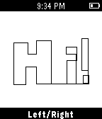

<!-- Generated by scripts/update_app_directory.py: do not edit by hand -->
[← All Pebble Developers](../developers.md)

# Brian Zwahr

*1 app · Last updated 2026-10-11 · [About these lists](../about-app-lists.md)*

Links: [Pebble App Store](https://apps.repebble.com/apps/dev/brian-zwahr_54a44752ea825781c10000c4) · [GitHub (echosa)](https://github.com/echosa)

<h2 class="app-name" id="app-54b49f22daa5498e85000006"><a href="https://apps.repebble.com/54b49f22daa5498e85000006">Etchist</a> v2.0</h2>
<a class="app-source" href="https://github.com/echosa/Etchist" title="Source code" data-search-exclude>View source</a>

App

Released 2015-01-13 Updated 2015-12-17

Runs on: Round 2, Time 2, Pebble 2 Duo, Pebble 2, Time Round, Time, Classic

Etchist turns your Pebble into an Etch-a-sketch! Use the select button to toggle between drawing up/down and left/right. Shake to clear the screen!

