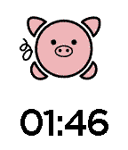

<!-- Generated by scripts/update_app_directory.py: do not edit by hand -->
[← All Pebble Developers](../developers.md)

# BrickFacts

*1 watchface · Last updated 2026-10-11 · [About these lists](../about-app-lists.md)*

Links: [Pebble App Store](https://apps.repebble.com/apps/dev/brickfacts_5378643143e90add3c00005d) · [GitHub (PiggyShake)](https://github.com/PiggyShake) · [Website (piggyshake.com)](http://piggyshake.com)

<h2 class="app-name" id="app-55d04c38b784735b870000b3"><a href="https://apps.repebble.com/55d04c38b784735b870000b3">PiggyShake</a> v2.0</h2>
<a class="app-source" href="https://github.com/PiggyShake" title="Source code" data-search-exclude>View source</a>

Watchface

Released 2015-08-16 Updated 2015-08-16

Runs on: Time 2, Time

An interactive and social watch face with a cute dancing pig.

