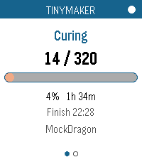
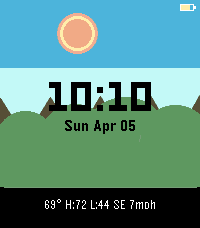
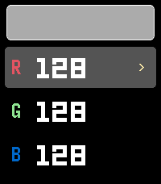
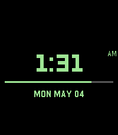
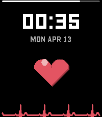

<!-- Generated by scripts/update_app_directory.py: do not edit by hand -->
[← All Pebble Developers](../developers.md)

# Brooman Inks

*6 watchfaces and 4 apps · Last updated 2026-10-11 · [About these lists](../about-app-lists.md)*

Links: [Pebble App Store](https://apps.repebble.com/apps/dev/brooman-inks_44b97418cf47663c00fb67bc) · [GitHub (brooks2564)](https://github.com/brooks2564)

<button type="button" data-filter="all" aria-pressed="true">All 10</button><button type="button" data-filter="watchface" aria-pressed="false">Watchfaces 6</button><button type="button" data-filter="watchapp" aria-pressed="false">Apps 4</button>

<label class="dev-sort">Sort by <select><option value="updated">Recently updated</option><option value="released">Newest release</option><option value="title">A–Z</option></select></label>

<h2 class="app-name" id="app-43c6b549267b48e5abd78dca"><a href="https://apps.repebble.com/43c6b549267b48e5abd78dca">NHL Live Scores</a> v1.2.0</h2>
<a class="app-source" href="https://github.com/brooks2564/Pebble-NHL-Live" title="Source code" data-search-exclude>View source</a>

Watchface

No licence Released 2026-04-18 Updated 2026-10-03

Runs on: Time 2, Pebble 2 Duo, Pebble 2, Time, Classic

NHL Scores

<h2 class="app-name" id="app-6c0eeeaeb5484d4f99a1f030"><a href="https://apps.repebble.com/6c0eeeaeb5484d4f99a1f030">NFL Live Scores</a> v1.0.0</h2>
<a class="app-source" href="https://github.com/brooks2564/Pebble-NFL-Live" title="Source code" data-search-exclude>View source</a>

Watchface

No licence Released 2026-09-14 Updated 2026-09-14

Runs on: Time 2, Pebble 2 Duo, Pebble 2, Time, Classic

NFL Live Scores for Pebble Stuck in a meeting? Can&#x27;t watch the game? Don&#x27;t worry - keep the score on your wrist. NFL Live Scores updates every minute straight from ESPN&#x27;s public scoreboard API, so…

<h2 class="app-name" id="app-7fa7ce8511334007a8756c53"><a href="https://apps.repebble.com/7fa7ce8511334007a8756c53">TinyMaker Monitor</a> v1.0.0</h2>
<a class="app-source" href="https://github.com/brooks2564/Pebble-Tiny-Maker-App" title="Source code" data-search-exclude>View source</a>

App

No licence Released 2026-09-05 Updated 2026-09-05

Runs on: Round 2, Time 2, Pebble 2 Duo, Pebble 2, Time Round, Time, Classic

Watch a print on your TinyMaker resin printer from your wrist. Layer count, time left, resin level — live, on any Pebble. Requires the TinyMakerWifi community firmware…

<h2 class="app-name" id="app-0e450d792bd44863af3f313a"><a href="https://apps.repebble.com/0e450d792bd44863af3f313a">Trivia for Pebble</a> v2.0.0</h2>
<a class="app-source" href="https://github.com/brooks2564/Pebble-Trivia" title="Source code" data-search-exclude>View source</a>

App

No licence Released 2026-04-07 Updated 2026-05-14

Runs on: Round 2, Time 2, Pebble 2 Duo, Pebble 2, Time Round, Time, Classic

❓Pebble Trivia A trivia game for Pebble smartwatches. Questions pulled live from the Open Trivia Database - completely free, no account or API key needed. 🕹️How to Play 1. Pick a category When you…

<h2 class="app-name" id="app-887baf372376490ba9ea1ba8"><a href="https://apps.repebble.com/887baf372376490ba9ea1ba8">Solstice</a> v2.2.2</h2>
<a class="app-source" href="https://github.com/brooks2564/Pebble-WF-Pebble-Solstice" title="Source code" data-search-exclude>View source</a>

Watchface

No licence Released 2026-04-05 Updated 2026-05-14

Runs on: Round 2, Time 2, Pebble 2 Duo, Pebble 2, Time Round, Time, Classic

Solstice - A Living Landscape Watchface

<h2 class="app-name" id="app-d0bf4929609b4a1baa6ba168"><a href="https://apps.repebble.com/d0bf4929609b4a1baa6ba168">RGB Backlight Test</a> v1.0</h2>
<a class="app-source" href="https://github.com/brooks2564/rgb-backlight-test" title="Source code" data-search-exclude>View source</a>

App

No licence Released 2026-05-05 Updated 2026-05-05

Runs on: Time 2

RGB Backlight Test A Pebble app for the Pebble Time 2 (Emery) to interactively test the RGB backlight using the new light_set_color_rgb888() API introduced in SDK 4.9.169. Features Live R, G, B…

<h2 class="app-name" id="app-e62be379bf534a5c8142db2f"><a href="https://apps.repebble.com/e62be379bf534a5c8142db2f">Mini Golf Touch</a> v2.0</h2>
<a class="app-source" href="https://github.com/brooks2564/Pebble-Mini-Golf" title="Source code" data-search-exclude>View source</a>

App

No licence Released 2026-04-14 Updated 2026-05-04

Runs on: Round 2, Time 2, Pebble 2 Duo, Pebble 2, Time Round, Time, Classic

⛳ Pebble Mini Golf... Now with Touch Controls A fully playable mini golf game for Pebble smartwatches — now with full touch screen support on Pebble Time 2 and other touch-enabled models. Take on…

<h2 class="app-name" id="app-c2d3442de12841b09f2cc72b"><a href="https://apps.repebble.com/c2d3442de12841b09f2cc72b">Colors - Watch Face</a> v2.0</h2>
<a class="app-source" href="https://github.com/brooks2564/Pebble-Colors" title="Source code" data-search-exclude>View source</a>

Watchface

No licence Released 2026-03-17 Updated 2026-05-04

Runs on: Round 2, Time 2, Pebble 2 Duo, Pebble 2, Time Round, Time, Classic

Select your favorite color to be on your watch face!

<h2 class="app-name" id="app-5af360e35f5041998f9aa823"><a href="https://apps.repebble.com/5af360e35f5041998f9aa823">Lunar Phase</a> v2.0</h2>
<a class="app-source" href="https://github.com/brooks2564/Pebble-Lunar-Phase" title="Source code" data-search-exclude>View source</a>

Watchface

No licence Released 2026-04-20 Updated 2026-04-20

Runs on: Round 2, Time 2

Lunar Phase

<h2 class="app-name" id="app-fd6389cb6fb74c0dbe954144"><a href="https://apps.repebble.com/fd6389cb6fb74c0dbe954144">Vanity</a> v1.1</h2>
<a class="app-source" href="https://github.com/brooks2564/Pebble-Vanity" title="Source code" data-search-exclude>View source</a>

Watchface

No licence Released 2026-04-13 Updated 2026-04-13

Runs on: Round 2, Time 2, Pebble 2 Duo, Pebble 2, Time Round, Time, Classic

Vanity Most watchfaces show you the time. Vanity shows you how many people like it. It connects to the Pebble App Store, fetches its own heart count, and displays the number inside a big red heart…

