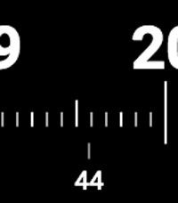

<!-- Generated by scripts/update_app_directory.py: do not edit by hand -->
[← All Pebble Developers](../developers.md)

# Bruno Lourenço

*1 watchface · Last updated 2026-10-12 · [About these lists](../about-app-lists.md)*

Links: [Rebble App Store](https://apps.rebble.io/en_US/developer/5846c8c800355a8e27000df3/1) · [GitHub (brunnolou)](https://github.com/brunnolou)

<h2 class="app-name" id="app-58471a9900355abe66000ddf"><a href="https://apps.rebble.io/en_US/application/58471a9900355abe66000ddf">24h watchface</a> v0.0</h2>
<a class="app-source" href="https://github.com/brunnolou/24h-pebble-watchface" title="Source code" data-search-exclude>View source</a>

Watchface

GPL-3.0 Released 2016-12-06 Updated 2016-12-06 Rebble App Store

Runs on: Round 2, Time 2, Pebble 2 Duo, Pebble 2, Time Round, Time

Why the analog watches have two hands? Why show only 12h if we have 24h each day? Why should we care about all the other numbers if we only want to see the current hour and minute? Well, a digital…

