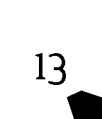

<!-- Generated by scripts/update_app_directory.py: do not edit by hand -->
[← All Pebble Developers](../developers.md)

# C. Munkelt

*1 watchface · Last updated 2026-10-11 · [About these lists](../about-app-lists.md)*

Links: [Pebble App Store](https://apps.repebble.com/apps/dev/c-munkelt_53e375142d39fc5ffc00009e) · [GitHub (CMun)](https://github.com/CMun)

<h2 class="app-name" id="app-541584d8ef53049a2300005b"><a href="https://apps.repebble.com/541584d8ef53049a2300005b">Uncertainty Time</a> v1.0</h2>
<a class="app-source" href="https://github.com/CMun/UncertaintyTime" title="Source code" data-search-exclude>View source</a>

Watchface

MIT Released 2014-09-14 Updated 2014-09-28

Runs on: Time 2, Pebble 2 Duo, Pebble 2, Time, Classic

This watch face displays the time in a minimalistic, battery preserving fashion. The display gets refreshed only every eighth of an hour. The inner number shows the hour, the outer indicator the…

