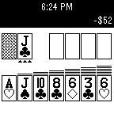

<!-- Generated by scripts/update_app_directory.py: do not edit by hand -->
[← All Pebble Developers](../developers.md)

# calamari Software

*1 watchface and 1 app · Last updated 2026-10-12 · [About these lists](../about-app-lists.md)*

Links: [Pebble App Store](https://apps.repebble.com/apps/dev/calamari-software_53cb0606f87b113d8700000d) · [Website (code.google.com)](https://code.google.com/p/pebble-watchfaces/)

<button type="button" data-filter="all" aria-pressed="true">All 2</button><button type="button" data-filter="watchface" aria-pressed="false">Watchfaces 1</button><button type="button" data-filter="watchapp" aria-pressed="false">Apps 1</button>

<label class="dev-sort">Sort by <select><option value="updated">Recently updated</option><option value="released">Newest release</option><option value="title">A–Z</option></select></label>

<h2 class="app-name" id="app-53f98c8625ab8a8f33000091"><a href="https://apps.repebble.com/53f98c8625ab8a8f33000091">Fluttershy</a> v1.0</h2>
<a class="app-source" href="https://code.google.com/p/pebble-watchfaces/source/browse/" title="Source code" data-search-exclude>View source</a>

Watchface

Released 2014-08-24 Updated 2014-08-24

Runs on: Time 2, Pebble 2 Duo, Pebble 2, Time, Classic

Have the cutest pony tell you the time! Features the time, date (month and day), weekday, and battery level. The presence of her cutie mark indicates whether there is a bluetooth connection…

<h2 class="app-name" id="app-53db2daae4fa76655c000077"><a href="https://apps.repebble.com/53db2daae4fa76655c000077">Solitaire</a> v1.0.0</h2>
<a class="app-source" href="http://code.google.com/p/pebble-solitaire/source/browse/" title="Source code" data-search-exclude>View source</a>

App

Released 2014-08-01 Updated 2014-08-01

Runs on: Time 2, Pebble 2 Duo, Pebble 2, Time, Classic

Klondike Solitaire for Pebble. Includes Vegas scoring, one and three card draw modes, and selectable flip limit. Controls allow you to automatically skip over ineligible piles and move cards to…

