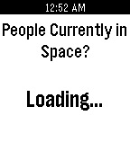

<!-- Generated by scripts/update_app_directory.py: do not edit by hand -->
[← All Pebble Developers](../developers.md)

# Cameron Bernhardt

*1 app · Last updated 2026-10-12 · [About these lists](../about-app-lists.md)*

Links: [Pebble App Store](https://apps.repebble.com/apps/dev/cameron-bernhardt_52b23861cd4183412300008d) · [GitHub (AstronomyiPhone)](https://github.com/AstronomyiPhone)

<h2 class="app-name" id="app-5307eed3ab1ae26bc700006c"><a href="https://apps.repebble.com/5307eed3ab1ae26bc700006c">Who&#x27;s In Space?</a> v2.1.2</h2>
<a class="app-source" href="https://github.com/AstronomyiPhone/PebbleAstronauts" title="Source code" data-search-exclude>View source</a>

App

No licence Released 2014-02-22 Updated 2014-07-13

Runs on: Time 2, Pebble 2 Duo, Pebble 2, Time, Classic

Quickly find out who&#x27;s currently in space and their dwellings. Data is provided by the Open Notify API, which licensed under the Creative Commons Attribution 3.0 Unported License.

