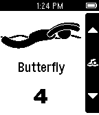

<!-- Generated by scripts/update_app_directory.py: do not edit by hand -->
[← All Pebble Developers](../developers.md)

# Cameron Wilby

*1 app · Last updated 2026-10-12 · [About these lists](../about-app-lists.md)*

Links: [Pebble App Store](https://apps.repebble.com/apps/dev/cameron-wilby_531ce0582ef7d3157d000374) · [GitHub (cameronwilby)](https://github.com/cameronwilby) · [Website (cameronwilby.com)](http://www.cameronwilby.com/swim-counter)

<h2 class="app-name" id="app-5336673782fdcfe028000008"><a href="https://apps.repebble.com/5336673782fdcfe028000008">Swim Counter</a> v1.0.1</h2>
<a class="app-source" href="https://github.com/cameronwilby/swim-counter" title="Source code" data-search-exclude>View source</a>

App

MIT Released 2014-03-29 Updated 2014-03-29

Runs on: Time 2, Pebble 2 Duo, Pebble 2, Time, Classic

A basic app that counts lengths of the four main swimming strokes. Utilize the Pebble’s ability to be taken underwater.

