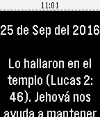

<!-- Generated by scripts/update_app_directory.py: do not edit by hand -->
[← All Pebble Developers](../developers.md)

# Camilo Tabares

*1 app · Last updated 2026-10-12 · [About these lists](../about-app-lists.md)*

Links: [Pebble App Store](https://apps.repebble.com/apps/dev/camilo-tabares_559cab25b703a62df100009c) · [GitHub (soycamiloypunto)](https://github.com/soycamiloypunto)

<h2 class="app-name" id="app-56a28232956f0b99f1000050"><a href="https://apps.repebble.com/56a28232956f0b99f1000050">Texto Diario 2016</a> v1.5</h2>
<a class="app-source" href="https://github.com/soycamiloypunto/Examinando2016" title="Source code" data-search-exclude>View source</a>

App

Released 2016-01-22 Updated 2019-07-24

Runs on: Round 2, Time 2, Pebble 2 Duo, Pebble 2, Time Round, Time, Classic

Muchos quisieramos tener un texto bíblico para meditar en él, durante la escuela o el trabajo. Ahora podrás revisar el Texto del Año, Texto del Día y el comentario de la Atalaya desde tu Pebble…

