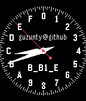

<!-- Generated by scripts/update_app_directory.py: do not edit by hand -->
[← All Pebble Developers](../developers.md)

# Campbell

*1 watchface · Last updated 2026-10-12 · [About these lists](../about-app-lists.md)*

Links: [Pebble App Store](https://apps.repebble.com/apps/dev/campbell_55ba7726d7e075209400007b) · [GitHub (Guzunty)](https://github.com/Guzunty)

<h2 class="app-name" id="app-55f30234b3b7022bb60000ac"><a href="https://apps.repebble.com/55f30234b3b7022bb60000ac">HexTime</a> v1.0</h2>
<a class="app-source" href="https://github.com/Guzunty/Pebble.git" title="Source code" data-search-exclude>View source</a>

Watchface

No licence Released 2015-09-11 Updated 2015-09-11

Runs on: Time 2, Pebble 2 Duo, Pebble 2, Time, Classic

Hextime is a new way to tell the time. It divides the day into 16 hex hours, not 24. There are 256 hex minutes in a hex hour and 16 hex seconds in a hex minute. A hex hour is 1.5 normal hours, so…

