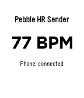

<!-- Generated by scripts/update_app_directory.py: do not edit by hand -->
[← All Pebble Developers](../developers.md)

# Can Köprülü

*1 app · Last updated 2026-10-12 · [About these lists](../about-app-lists.md)*

Links: [Pebble App Store](https://apps.repebble.com/apps/dev/can-k-pr-l_d3ad2af71c340658ae220e38) · [GitHub (koprulucan)](https://github.com/koprulucan)

<h2 class="app-name" id="app-8dc4a43c3b244d85aeac474b"><a href="https://apps.repebble.com/8dc4a43c3b244d85aeac474b">Can&#x27;s HR Sender for Pebble</a> v0.2.1</h2>
<a class="app-source" href="https://github.com/koprulucan/Cans_Pebbleton_HR_Sender" title="Source code" data-search-exclude>View source</a>

App

Released 2026-08-26 Updated 2026-08-26

Runs on: Time 2, Pebble 2 Duo, Pebble 2

Can&#x27;s HR Sender for Pebble is a Pebble watch app that reads live heart-rate data from the watch and sends it to the Android companion app Can&#x27;s Pebbleton HR Bridge. Together, the two apps make the…

