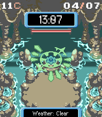

<!-- Generated by scripts/update_app_directory.py: do not edit by hand -->
[← All Pebble Developers](../developers.md)

# Capypara

*1 watchface · Last updated 2026-10-12 · [About these lists](../about-app-lists.md)*

Links: [Pebble App Store](https://apps.repebble.com/apps/dev/capypara_5759dedd45e8d38733000005) · [GitHub (theCapypara)](https://github.com/theCapypara)

<h2 class="app-name" id="app-57dd188b2d0cc8673f00027b"><a href="https://apps.repebble.com/57dd188b2d0cc8673f00027b">Time Gear</a> v1.2</h2>
<a class="app-source" href="https://github.com/theCapypara/PebbleTimeGear" title="Source code" data-search-exclude>View source</a>

Watchface · <a href="https://forum.rebble.io/t/842" title="Discuss this app on the Rebble forum" data-search-exclude>Forum thread</a>

Released 2016-09-17 Updated 2026-04-07

Runs on: Round 2, Time 2, Pebble 2 Duo, Pebble 2, Time Round, Time, Classic

A watchface in the style of Pokémon Mystery Dungeon (PMD) Sky / Time / Darkness. It features Time Gears from the game and comes with three backgrounds from the game. Features (all can be…

