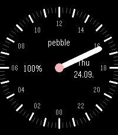
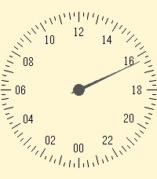
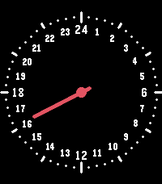

<!-- Generated by scripts/update_app_directory.py: do not edit by hand -->
[← All Pebble Developers](../developers.md)

# Carl-Fredrik Arvidson

*3 watchfaces · Last updated 2026-10-12 · [About these lists](../about-app-lists.md)*

Links: [Pebble App Store](https://apps.repebble.com/apps/dev/carl-fredrik-arvidson_8030a3976177840c1696a0f5) · [GitHub (cfarvidson)](https://github.com/cfarvidson)

<button type="button" data-filter="all" aria-pressed="true">All 3</button><button type="button" data-filter="watchface" aria-pressed="false">Watchfaces 3</button><button type="button" data-filter="watchapp" aria-pressed="false" disabled>Apps 0</button>

<label class="dev-sort">Sort by <select><option value="updated">Recently updated</option><option value="released">Newest release</option><option value="title">A–Z</option></select></label>

<h2 class="app-name" id="app-8adb686039f747f98e0414d4"><a href="https://apps.repebble.com/8adb686039f747f98e0414d4">Varv</a> v1.1.0</h2>
<a class="app-source" href="https://github.com/cfarvidson/pebble-varv" title="Source code" data-search-exclude>View source</a>

Watchface

No licence Released 2026-09-24 Updated 2026-09-24

Runs on: Time 2

24-hour watchface with a single long hand for Pebble Time 2. One rotation per day: noon at the top, midnight at the bottom. Black dial with quarter-hour ticks and small even-hour numerals, battery…

<h2 class="app-name" id="app-0bd92532c7a04f1fadba71a1"><a href="https://apps.repebble.com/0bd92532c7a04f1fadba71a1">Sakta</a> v1.0.0</h2>
<a class="app-source" href="https://github.com/cfarvidson/pebble-sakta" title="Source code" data-search-exclude>View source</a>

Watchface

No licence Released 2026-09-24 Updated 2026-09-24

Runs on: Time 2

24-hour watchface with a single hand for Pebble Time 2, inspired by the slow Jo 17 and slow Mo 02. One rotation per day: noon at the top, midnight at the bottom. Cream, white or black dial…

<h2 class="app-name" id="app-3e0e8d5a0a3c4bcfaeeb7b22"><a href="https://apps.repebble.com/3e0e8d5a0a3c4bcfaeeb7b22">Dygn</a> v1.1.0</h2>
<a class="app-source" href="https://github.com/cfarvidson/pebble-dygn" title="Source code" data-search-exclude>View source</a>

Watchface

No licence Released 2026-09-24 Updated 2026-09-24

Runs on: Time 2

24-hour watchface with a single hand for Pebble Time 2. One rotation per day: midnight (24) at the top, noon (12) at the bottom. Black dial, white numerals, minute dots, a red hand. Optional…

