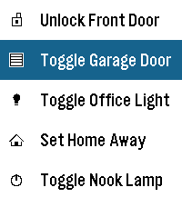

<!-- Generated by scripts/update_app_directory.py: do not edit by hand -->
[← All Pebble Developers](../developers.md)

# Carles F.

*1 app · Last updated 2026-10-11 · [About these lists](../about-app-lists.md)*

Links: [Pebble App Store](https://apps.repebble.com/apps/dev/carles-f_e5ecc09ef751ee01835def60) · [GitHub (Carles-Figuerola)](https://github.com/Carles-Figuerola)

<h2 class="app-name" id="app-24d2de46621142018096799a"><a href="https://apps.repebble.com/24d2de46621142018096799a">Home Assistant Shortcuts</a> v1.1</h2>
<a class="app-source" href="https://github.com/Carles-Figuerola/home-assistant-shortcuts" title="Source code" data-search-exclude>View source</a>

App

No licence Released 2026-03-27 Updated 2026-03-27

Runs on: Round 2, Time 2, Pebble 2 Duo, Pebble 2, Time Round, Time, Classic

This application is a very simple home-assistant script-caller. The goal of the application is to be as simple as possible. It won&#x27;t autodetect everything that you have configured or won&#x27;t check…

