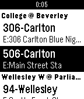

<!-- Generated by scripts/update_app_directory.py: do not edit by hand -->
[← All Pebble Developers](../developers.md)

# Carlos Duarte Do Nascimento (Chester)

*1 app · Last updated 2026-10-11 · [About these lists](../about-app-lists.md)*

Links: [Pebble App Store](https://apps.repebble.com/apps/dev/carlos-duarte-do-nascimento-chester_54b460056d1940ffa90000aa) · [GitHub (chesterbr)](https://github.com/chesterbr) · [Website (chester.me)](http://chester.me)

<h2 class="app-name" id="app-57315941c351ffcdf500000f"><a href="https://apps.repebble.com/57315941c351ffcdf500000f">Toronto Transit Time</a> v1.1</h2>
<a class="app-source" href="https://github.com/chesterbr/toronto-transit-time/" title="Source code" data-search-exclude>View source</a>

App

Released 2016-05-10 Updated 2016-10-19

Runs on: Round 2, Time 2, Pebble 2 Duo, Pebble 2, Time Round, Time, Classic

Get realtime arrival predicitons and service messages for bus and streetcar routes at the nearest stops directly on your Pebble - no extra app required.

