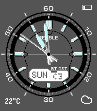

<!-- Generated by scripts/update_app_directory.py: do not edit by hand -->
[← All Pebble Developers](../developers.md)

# Carlos Roque

*1 watchface · Last updated 2026-10-11 · [About these lists](../about-app-lists.md)*

Links: [Pebble App Store](https://apps.repebble.com/apps/dev/carlos-roque_69f79acb1d744d0008beada2) · [GitHub (CarlosRoque)](https://github.com/CarlosRoque)

<h2 class="app-name" id="app-69f79e8c6d87af0009514695"><a href="https://apps.repebble.com/69f79e8c6d87af0009514695">Casio WVA-M640D</a> v1.0.6</h2>
<a class="app-source" href="https://github.com/CarlosRoque/Pebble-Casio-WVA-M640D" title="Source code" data-search-exclude>View source</a>

Watchface · <a href="https://forum.rebble.io/t/945" title="Discuss this app on the Rebble forum" data-search-exclude>Forum thread</a>

No licence Released 2026-05-03 Updated 2026-05-29

Runs on: Time 2

Inspired by the iconic Casio WVA-M640D. Includes the following functionality: Analog hands — Hour, minute, and seconds hand. Flick to show seconds — Flick your wrist to reveal the seconds hand for…

