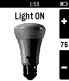

<!-- Generated by scripts/update_app_directory.py: do not edit by hand -->
[← All Pebble Developers](../developers.md)

# carlosperate

*1 app · Last updated 2026-10-12 · [About these lists](../about-app-lists.md)*

Links: [Pebble App Store](https://apps.repebble.com/apps/dev/carlosperate_5492cf2a8718b2c8070000ea) · [GitHub (carlosperate)](https://github.com/carlosperate) · [Website (quickhue.embeddedlog.com)](http://quickhue.embeddedlog.com)

<h2 class="app-name" id="app-5526f89e1c36ea04bd00006b"><a href="https://apps.repebble.com/5526f89e1c36ea04bd00006b">QuickHue</a> v0.3</h2>
<a class="app-source" href="http://github.com/carlosperate/PebbleQuickHue" title="Source code" data-search-exclude>View source</a>

App

MIT Released 2015-04-09 Updated 2026-04-18

Runs on: Time 2, Pebble 2 Duo, Pebble 2, Time, Classic

Pebble app to facilitate quick control of a Philips Hue light bulb. It will toggle the preselected light ON or OFF as soon as the app loads, so it is designed to be registered as a button shortcut…

