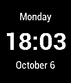

<!-- Generated by scripts/update_app_directory.py: do not edit by hand -->
[← All Pebble Developers](../developers.md)

# carthobock

*1 watchface · Last updated 2026-10-12 · [About these lists](../about-app-lists.md)*

Links: [Pebble App Store](https://apps.repebble.com/apps/dev/carthobock_571e56073603cec7e6000011) · [Website (careybockting.com)](http://www.careybockting.com/)

<h2 class="app-name" id="app-57217e99fc18dd9fbc000020"><a href="https://apps.repebble.com/57217e99fc18dd9fbc000020">CB Simple</a> v1.3</h2>
<a class="app-source" href="http://www.careybockting.com/pebble/" title="Source code" data-search-exclude>View source</a>

Watchface

Released 2016-04-28 Updated 2016-05-27

Runs on: Round 2, Time 2, Pebble 2 Duo, Pebble 2, Time Round, Time, Classic

A minimalistic watchface optimized for battery life featuring date and time. - Uses Pebble stock fonts. - Displays both 12h and 24h time. Adapts to native Pebble settings (settings&gt;date &amp;…

