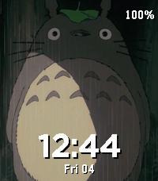

<!-- Generated by scripts/update_app_directory.py: do not edit by hand -->
[← All Pebble Developers](../developers.md)

# Case

*2 watchfaces · Last updated 2026-10-11 · [About these lists](../about-app-lists.md)*

Links: [Pebble App Store](https://apps.repebble.com/apps/dev/case_e47ae62c235d9214790daedc) · [GitHub (tomrav)](https://github.com/tomrav)

<button type="button" data-filter="all" aria-pressed="true">All 2</button><button type="button" data-filter="watchface" aria-pressed="false">Watchfaces 2</button><button type="button" data-filter="watchapp" aria-pressed="false" disabled>Apps 0</button>

<label class="dev-sort">Sort by <select><option value="updated">Recently updated</option><option value="released">Newest release</option><option value="title">A–Z</option></select></label>

<h2 class="app-name" id="app-c1609136e0a3430bb1bf52b1"><a href="https://apps.repebble.com/c1609136e0a3430bb1bf52b1">Photo Face</a> v1.1.8</h2>
<a class="app-source" href="https://github.com/tomrav/pebble-image-faces" title="Source code" data-search-exclude>View source</a>

Watchface

Released 2026-08-06 Updated 2026-09-28

Runs on: Time 2

Photo Face turns your Pebble Time 2 into a photo frame with a clock, filled with your own photos. Your photos: - Add as many as you like from the settings page and arrange them into galleries you…

<h2 class="app-name" id="app-fc26309e8f9a44f9b70fbc9d"><a href="https://apps.repebble.com/fc26309e8f9a44f9b70fbc9d">Ghibli Time</a> v1.3.6</h2>
<a class="app-source" href="https://github.com/tomrav/pebble-image-faces" title="Source code" data-search-exclude>View source</a>

Watchface

Released 2026-08-08 Updated 2026-09-28

Runs on: Time 2

Studio Ghibli&#x27;s friends, films and paintings drift past your wrist. The collection: - 67 images: 44 characters, film posters, official key art - Choose what rotates on the settings page; a new…

