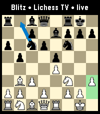
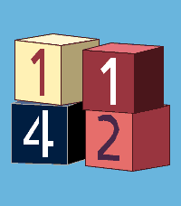
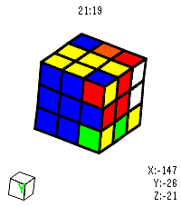

<!-- Generated by scripts/update_app_directory.py: do not edit by hand -->
[← All Pebble Developers](../developers.md)

# CATEIN

*1 watchface and 3 apps · Last updated 2026-10-11 · [About these lists](../about-app-lists.md)*

Links: [Pebble App Store](https://apps.repebble.com/apps/dev/catein_5451ddc920d58674e460e802) · [GitHub (CATEIN)](https://github.com/CATEIN)

<button type="button" data-filter="all" aria-pressed="true">All 4</button><button type="button" data-filter="watchface" aria-pressed="false">Watchfaces 1</button><button type="button" data-filter="watchapp" aria-pressed="false">Apps 3</button>

<label class="dev-sort">Sort by <select><option value="updated">Recently updated</option><option value="released">Newest release</option><option value="title">A–Z</option></select></label>

<h2 class="app-name" id="app-42e5e2cf8c1e4dcdac540555"><a href="https://apps.repebble.com/42e5e2cf8c1e4dcdac540555">Lichess TV</a> v1.2.0</h2>
<a class="app-source" href="https://github.com/CATEIN/lichess-tv-for-pebble" title="Source code" data-search-exclude>View source</a>

App

MIT Released 2026-08-12 Updated 2026-10-07

Runs on: Round 2, Time 2

Watch live chess, on your wrist! Lichess TV streams a live game position to your watch as it happens: every move, both players&#x27; names, titles, and ratings, and clocks that count down in real time…

<h2 class="app-name" id="app-92d7342455c741eeb3e4565d"><a href="https://apps.repebble.com/92d7342455c741eeb3e4565d">One and Only</a> v1.0.0</h2>
<a class="app-source" href="https://github.com/CATEIN/one-and-only-time-2" title="Source code" data-search-exclude>View source</a>

App

Other Released 2026-10-01 Updated 2026-10-01

Runs on: Time 2

SAM, the 1982 speech synthesizer, sings &quot;One and Only&quot; by rai1367, with a 3D wireframe music video. It&#x27;s all made on the watch as it plays: SAM&#x27;s voice (lead and harmony), the bass and the keys…

<h2 class="app-name" id="app-d2e8cdffa67e43a985d3ddf7"><a href="https://apps.repebble.com/d2e8cdffa67e43a985d3ddf7">Playtime</a> v1.2.0</h2>
<a class="app-source" href="https://github.com/CATEIN/playtime-pebble" title="Source code" data-search-exclude>View source</a>

Watchface

MIT Released 2026-09-25 Updated 2026-09-28

Runs on: Round 2, Time 2, Pebble 2 Duo, Pebble 2, Time Round, Time, Classic

Tell the time with a stack of 3D toy blocks — lazily stacked, randomly colored, always playful. The hour sits on top, the minutes on the bottom, one stencil number per block. SHUFFLE IT UP (all on…

<h2 class="app-name" id="app-accc6b0ed4da421198f5e503"><a href="https://apps.repebble.com/accc6b0ed4da421198f5e503">Rubik&#x27;s Cube</a> v1.0.0</h2>
<a class="app-source" href="https://github.com/CATEIN/rubiks-cube-for-pebble" title="Source code" data-search-exclude>View source</a>

App

MIT Released 2026-08-29 Updated 2026-08-29

Runs on: Time 2

Virtual Rubik&#x27;s Cube for Pebble Time 2. I got close to solving it but messed up on the last layer 😭 Open source so yall can fork and make it better. Made using Claude.

