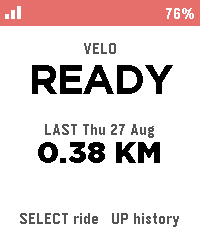

<!-- Generated by scripts/update_app_directory.py: do not edit by hand -->
[← All Pebble Developers](../developers.md)

# Caulfield

*1 app · Last updated 2026-10-11 · [About these lists](../about-app-lists.md)*

Links: [Pebble App Store](https://apps.repebble.com/apps/dev/caulfield_69f2a56cd7532300093a8deb) · [GitHub (Schmaxine1024)](https://github.com/Schmaxine1024)

<h2 class="app-name" id="app-6a9079ee06d133000845328c"><a href="https://apps.repebble.com/6a9079ee06d133000845328c">Velo</a> v1.0.2</h2>
<a class="app-source" href="https://github.com/Schmaxine1024/velo" title="Source code" data-search-exclude>View source</a>

App · <a href="https://forum.rebble.io/t/1287" title="Discuss this app on the Rebble forum" data-search-exclude>Forum thread</a>

No licence Released 2026-08-27 Updated 2026-08-27

Runs on: Round 2, Time 2, Pebble 2 Duo, Pebble 2, Time Round, Time

Biking/Cycling Companion for your Pebble, local to your pebble. Download the companion app for your phone and click select to start tracking, currently tracks the following metrics: -Current speed…

