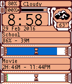

<!-- Generated by scripts/update_app_directory.py: do not edit by hand -->
[← All Pebble Developers](../developers.md)

# centuryglass

*1 watchface · Last updated 2026-10-11 · [About these lists](../about-app-lists.md)*

Links: [Pebble App Store](https://apps.repebble.com/apps/dev/centuryglass_5478fc07f94378516e000098) · [GitHub (centuryglass)](https://github.com/centuryglass)

<h2 class="app-name" id="app-56a8516af58e6beebf000019"><a href="https://apps.repebble.com/56a8516af58e6beebf000019">EventPercent</a> v1.12</h2>
<a class="app-source" href="https://github.com/centuryglass/eventwatch" title="Source code" data-search-exclude>View source</a>

Watchface

No licence Released 2016-01-27 Updated 2016-03-06

Runs on: Round 2, Time 2, Pebble 2 Duo, Pebble 2, Time Round, Time, Classic

EventPercent watchface shows you what percent of your calendar event has already passed, or how long you have until future events start. Events are automatically fetched from calendars on your…

