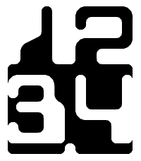

<!-- Generated by scripts/update_app_directory.py: do not edit by hand -->
[← All Pebble Developers](../developers.md)

# Ceri Thomas

*1 watchface · Last updated 2026-10-12 · [About these lists](../about-app-lists.md)*

Links: [Pebble App Store](https://apps.repebble.com/apps/dev/ceri-thomas_6a71b1de901cc50007556e13) · [GitHub (thosworth)](https://github.com/thosworth)

<h2 class="app-name" id="app-6a71da9449abe20009934ba7"><a href="https://apps.repebble.com/6a71da9449abe20009934ba7">RetroFuture</a> v1.0.5</h2>
<a class="app-source" href="https://github.com/thosworth/retrofuture-pebble-watchface" title="Source code" data-search-exclude>View source</a>

Watchface · <a href="https://forum.rebble.io/t/1238" title="Discuss this app on the Rebble forum" data-search-exclude>Forum thread</a>

Released 2026-08-04 Updated 2026-08-17

Runs on: Time 2

“We may now be earthbound here in the 1970s, but by the year 2000 many humans will be living and working in moon cities, and our multi-functional wristwatches will look like this.” This design is…

