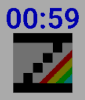

<!-- Generated by scripts/update_app_directory.py: do not edit by hand -->
[← All Pebble Developers](../developers.md)

# Cesar Hernandez

*1 watchface and 1 app · Last updated 2026-10-12 · [About these lists](../about-app-lists.md)*

Links: [Pebble App Store](https://apps.repebble.com/apps/dev/cesar-hernandez_caddaac1097dcb3aed14d135) · [GitHub (chernandezba)](https://github.com/chernandezba)

<button type="button" data-filter="all" aria-pressed="true">All 2</button><button type="button" data-filter="watchface" aria-pressed="false">Watchfaces 1</button><button type="button" data-filter="watchapp" aria-pressed="false">Apps 1</button>

<label class="dev-sort">Sort by <select><option value="updated">Recently updated</option><option value="released">Newest release</option><option value="title">A–Z</option></select></label>

<h2 class="app-name" id="app-cdfec388a4a74aa89c27e51b"><a href="https://apps.repebble.com/cdfec388a4a74aa89c27e51b">zesarux-watchface</a> v1.7.1</h2>
<a class="app-source" href="https://github.com/chernandezba/zesarux-pebble-watchface" title="Source code" data-search-exclude>View source</a>

Watchface

GPL-3.0 Released 2026-06-03 Updated 2026-06-03

Runs on: Round 2, Time 2, Pebble 2 Duo, Pebble 2, Time Round, Time, Classic

Simple ZEsarUX emulator watchface Color stripes can be animated every minute, chosen on settings. When tapping Pebble, the number of ZEsarUX yesterday users will be shown

<h2 class="app-name" id="app-fe736f2b36744abca1e31a23"><a href="https://apps.repebble.com/fe736f2b36744abca1e31a23">Catcher</a> v1.5</h2>
<a class="app-source" href="https://github.com/chernandezba/david_hernandez_bano/tree/main/pebble/catcher" title="Source code" data-search-exclude>View source</a>

App

GPL-3.0 Released 2026-06-03 Updated 2026-06-03

Runs on: Time 2, Pebble 2 Duo, Pebble 2, Time, Classic

This is the last version released after his author, David (my brother), passed away on 2023. It&#x27;s a simple catcher game. You have 2 modes of play : time mode and lives mode. In time mode you will…

