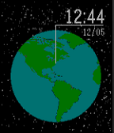

<!-- Generated by scripts/update_app_directory.py: do not edit by hand -->
[← All Pebble Developers](../developers.md)

# CHA

*1 watchface · Last updated 2026-10-11 · [About these lists](../about-app-lists.md)*

Links: [Pebble App Store](https://apps.repebble.com/apps/dev/cha_5501cf747ed24ab4f200005f) · [GitHub (clemshubs)](https://github.com/clemshubs)

<h2 class="app-name" id="app-5551aaf4cf532cacf50000e4"><a href="https://apps.repebble.com/5551aaf4cf532cacf50000e4">Humble World Map</a> v1.07</h2>
<a class="app-source" href="https://github.com/clemshubs/WorldMapWatchFace" title="Source code" data-search-exclude>View source</a>

Watchface

Released 2015-05-12 Updated 2016-01-29

Runs on: Round 2, Time 2, Pebble 2 Duo, Pebble 2, Time Round, Time, Classic

This watchface shows your position in realtime on the Earth. More to come : Night map, Real stars positions, Clouds maybe, Whatever you suggest and I can put in it !

