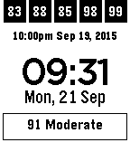
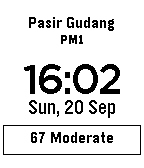

<!-- Generated by scripts/update_app_directory.py: do not edit by hand -->
[← All Pebble Developers](../developers.md)

# Chang Sau Sheong

*2 watchfaces · Last updated 2026-10-12 · [About these lists](../about-app-lists.md)*

Links: [Pebble App Store](https://apps.repebble.com/apps/dev/chang-sau-sheong_52f0214f4ae363f5c9000618) · [GitHub (sausheong)](https://github.com/sausheong)

<button type="button" data-filter="all" aria-pressed="true">All 2</button><button type="button" data-filter="watchface" aria-pressed="false">Watchfaces 2</button><button type="button" data-filter="watchapp" aria-pressed="false" disabled>Apps 0</button>

<label class="dev-sort">Sort by <select><option value="updated">Recently updated</option><option value="released">Newest release</option><option value="title">A–Z</option></select></label>

<h2 class="app-name" id="app-55fbe95c5150be7a9a00005c"><a href="https://apps.repebble.com/55fbe95c5150be7a9a00005c">SG Haze Watch</a> v1.3</h2>
<a class="app-source" href="https://github.com/sausheong/sghaze" title="Source code" data-search-exclude>View source</a>

Watchface

Released 2015-09-18 Updated 2015-09-21

Runs on: Time 2, Pebble 2 Duo, Pebble 2, Time, Classic

Simple watchface plus real-time Singapore PSI (Pollution Standard Index) numbers as provided by NEA. Top line represents the hourly PSI numbers in the north, west, center, east and south regions…

<h2 class="app-name" id="app-55fe6929722ec5f56800003c"><a href="https://apps.repebble.com/55fe6929722ec5f56800003c">MY Haze Watch</a> v1.0</h2>
<a class="app-source" href="https://github.com/sausheong/myhaze" title="Source code" data-search-exclude>View source</a>

Watchface

Released 2015-09-20 Updated 2015-09-20

Runs on: Time 2, Pebble 2 Duo, Pebble 2, Time, Classic

Simple watchface plus Malaysia Air Pollution Index (API) information from Malaysia Haze Watch (http://hazewatchapp.com). Top line is the nearest monitoring station, second line is the last update…

