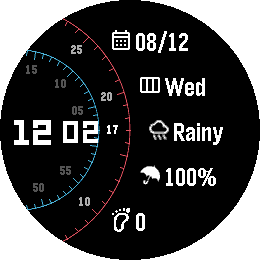
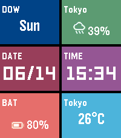
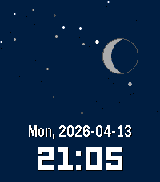

<!-- Generated by scripts/update_app_directory.py: do not edit by hand -->
[← All Pebble Developers](../developers.md)

# changing-k-tanaka

*3 watchfaces and 2 apps · Last updated 2026-10-12 · [About these lists](../about-app-lists.md)*

Links: [Pebble App Store](https://apps.repebble.com/apps/dev/changing-k-tanaka_69d06e418ce708000859e6f6) · [GitHub (changing-k-tanaka)](https://github.com/changing-k-tanaka)

<button type="button" data-filter="all" aria-pressed="true">All 5</button><button type="button" data-filter="watchface" aria-pressed="false">Watchfaces 3</button><button type="button" data-filter="watchapp" aria-pressed="false">Apps 2</button>

<label class="dev-sort">Sort by <select><option value="updated">Recently updated</option><option value="released">Newest release</option><option value="title">A–Z</option></select></label>

<h2 class="app-name" id="app-b7c0981249174152bdebc4a4"><a href="https://apps.repebble.com/b7c0981249174152bdebc4a4">Corridor Of Time</a> v1.0.0</h2>
<a class="app-source" href="https://github.com/changing-k-tanaka/pebble-watchface-corridor-of-time" title="Source code" data-search-exclude>View source</a>

Watchface

No licence Released 2026-08-12 Updated 2026-08-12

Runs on: Round 2, Time Round

Watchface for Round type Pebble Watch. You can customize the information displayed, the font color, and the background color This watch face is free. There are no additional charges. If you&#x27;d like…

<h2 class="app-name" id="app-1491156b8f6f46b1b305ec7c"><a href="https://apps.repebble.com/1491156b8f6f46b1b305ec7c">MetroTile</a> v2.1.2</h2>
<a class="app-source" href="https://github.com/changing-k-tanaka/pebble-watchface-MetroTile" title="Source code" data-search-exclude>View source</a>

Watchface

MIT Released 2026-04-11 Updated 2026-06-20

Runs on: Round 2, Time 2, Pebble 2 Duo, Pebble 2, Time Round, Time, Classic

This watch face is inspired by the Windows Metro UI. You can freely customize the display items, text color, and background color for the six tiles. Display options include date, time, day of the…

<h2 class="app-name" id="app-962806faa9fb4eb4a211acbd"><a href="https://apps.repebble.com/962806faa9fb4eb4a211acbd">Moonlit</a> v1.0.5</h2>
<a class="app-source" href="https://github.com/changing-k-tanaka/pebble-watchface-moonlit" title="Source code" data-search-exclude>View source</a>

Watchface

MIT Released 2026-04-13 Updated 2026-06-07

Runs on: Round 2, Time 2, Time Round, Time

This watch face depicts a moonlit night and a daytime view from the moon. Shooting stars and comets may appear in the night sky. You can select and display any two of the following: weather and…

<h2 class="app-name" id="app-8dc9802adc3745f08cc4c913"><a href="https://apps.repebble.com/8dc9802adc3745f08cc4c913">BearBell</a> v1.0.0</h2>
<a class="app-source" href="https://github.com/changing-k-tanaka/pebble-watchapp-bearbell" title="Source code" data-search-exclude>View source</a>

App

No licence Released 2026-05-03 Updated 2026-05-03

Runs on: Time 2, Pebble 2 Duo

This app might serve as an alternative to a bear bell. Bear bells are known as an effective preventive measure for alerting bears to human presence through sound and preventing unexpected…

<h2 class="app-name" id="app-69d079b774b3f70009ab30cd"><a href="https://apps.repebble.com/69d079b774b3f70009ab30cd">Color View Sample</a> v1.1</h2>
<a class="app-source" href="https://github.com/changing-k-tanaka/pebble-app-color-view-sample" title="Source code" data-search-exclude>View source</a>

App · <a href="https://forum.rebble.io/t/823" title="Discuss this app on the Rebble forum" data-search-exclude>Forum thread</a>

MIT Released 2026-04-04 Updated 2026-04-27

Runs on: Round 2, Time 2, Time Round, Time

This app is intended for development purposes. It allows you to view and check the 64 colors available on color-capable Pebble devices (currently only “Pebble Time” and “Pebble Time Round” are…

