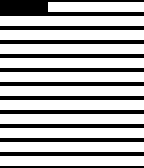
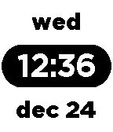
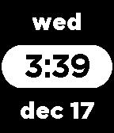

<!-- Generated by scripts/update_app_directory.py: do not edit by hand -->
[← All Pebble Developers](../developers.md)

# Charles Meyer

*3 watchfaces · Last updated 2026-10-11 · [About these lists](../about-app-lists.md)*

Links: [Pebble App Store](https://apps.repebble.com/apps/dev/charles-meyer_542b8b797a43169188000184) · [GitHub (charles-meyer)](https://github.com/charles-meyer)

<button type="button" data-filter="all" aria-pressed="true">All 3</button><button type="button" data-filter="watchface" aria-pressed="false">Watchfaces 3</button><button type="button" data-filter="watchapp" aria-pressed="false" disabled>Apps 0</button>

<label class="dev-sort">Sort by <select><option value="updated">Recently updated</option><option value="released">Newest release</option><option value="title">A–Z</option></select></label>

<h2 class="app-name" id="app-54a77ef0e8b7f578f1000017"><a href="https://apps.repebble.com/54a77ef0e8b7f578f1000017">GraphWatch</a> v1.01</h2>
<a class="app-source" href="http://github.com/charles-meyer/loading_watch" title="Source code" data-search-exclude>View source</a>

Watchface

No licence Released 2015-01-03 Updated 2015-01-03

Runs on: Time 2, Pebble 2 Duo, Pebble 2, Time, Classic

Watch the bars progress as the day goes by! Each bar represents one hour (in 12 hour time)

<h2 class="app-name" id="app-549afa9da003de7939000122"><a href="https://apps.repebble.com/549afa9da003de7939000122">BasicTime II</a> v1.0</h2>
<a class="app-source" href="https://github.com/charles-meyer/basic-watchface" title="Source code" data-search-exclude>View source</a>

Watchface

Released 2014-12-24 Updated 2014-12-25

Runs on: Time 2, Pebble 2 Duo, Pebble 2, Time, Classic

A minimalist time, date, and day of the week. Inverted colors of original BasicTime watchface.

<h2 class="app-name" id="app-548e2839f1f4ab6c44000029"><a href="https://apps.repebble.com/548e2839f1f4ab6c44000029">BasicTime</a> v1.1</h2>
<a class="app-source" href="https://github.com/charles-meyer/basic-watchface" title="Source code" data-search-exclude>View source</a>

Watchface

Released 2014-12-15 Updated 2014-12-17

Runs on: Time 2, Pebble 2 Duo, Pebble 2, Time, Classic

Minimalist, no nonsense, time, date, and day of the week.

