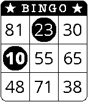

<!-- Generated by scripts/update_app_directory.py: do not edit by hand -->
[← All Pebble Developers](../developers.md)

# Charlie Hawker

*1 watchface · Last updated 2026-10-12 · [About these lists](../about-app-lists.md)*

Links: [Pebble App Store](https://apps.repebble.com/apps/dev/charlie-hawker_52ea7b820cc62470cf00004e) · [GitHub (CharlieHawker)](https://github.com/CharlieHawker) · [Website (charliehawker.com)](http://www.charliehawker.com)

<h2 class="app-name" id="app-52ee3bae94cc963caf00000e"><a href="https://apps.repebble.com/52ee3bae94cc963caf00000e">Bingo</a> v2.1.2</h2>
<a class="app-source" href="https://github.com/CharlieHawker/pebble-bingo-watchface/" title="Source code" data-search-exclude>View source</a>

Watchface

No licence Released 2014-02-02 Updated 2014-05-16

Runs on: Time 2, Pebble 2 Duo, Pebble 2, Time, Classic

Bingo-scorecard inspired watchface. Numbers not in use randomise each minute, highlighted cells change on the minute and hour as needed. If you like it, love it (♥) above! Feel free to get in…

