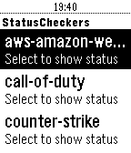

<!-- Generated by scripts/update_app_directory.py: do not edit by hand -->
[← All Pebble Developers](../developers.md)

# Chase

*2 apps · Last updated 2026-10-11 · [About these lists](../about-app-lists.md)*

Links: [Pebble App Store](https://apps.repebble.com/apps/dev/chase_5321b5897b6663c6ca0001d4) · [GitHub (deviavir)](https://github.com/deviavir)

<button type="button" data-filter="all" aria-pressed="true">All 2</button><button type="button" data-filter="watchface" aria-pressed="false" disabled>Watchfaces 0</button><button type="button" data-filter="watchapp" aria-pressed="false">Apps 2</button>

<label class="dev-sort">Sort by <select><option value="updated">Recently updated</option><option value="released">Newest release</option><option value="title">A–Z</option></select></label>

<h2 class="app-name" id="app-57536f158576a4e23f000010"><a href="https://apps.repebble.com/57536f158576a4e23f000010">OnOffHue</a> v1.0</h2>
<a class="app-source" href="https://github.com/deviavir/pebblehue" title="Source code" data-search-exclude>View source</a>

App

Released 2016-06-05 Updated 2016-12-22

Runs on: Round 2, Time 2, Pebble 2 Duo, Pebble 2, Time Round, Time, Classic

Control your hue lights from your wrist.

<h2 class="app-name" id="app-5707e10561753a0689000024"><a href="https://apps.repebble.com/5707e10561753a0689000024">StatusChecker</a> v0.4</h2>
<a class="app-source" href="https://github.com/DeviaVir/pebble-statuschecker" title="Source code" data-search-exclude>View source</a>

App

MIT Released 2016-04-08 Updated 2016-04-08

Runs on: Round 2, Time 2, Pebble 2 Duo, Pebble 2, Time Round, Time, Classic

A pebble app designed for webops-y people that would like to check certain website statuses from their watch.

