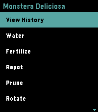

<!-- Generated by scripts/update_app_directory.py: do not edit by hand -->
[← All Pebble Developers](../developers.md)

# Chazmus

*1 app · Last updated 2026-10-12 · [About these lists](../about-app-lists.md)*

Links: [Pebble App Store](https://apps.repebble.com/apps/dev/chazmus_942af01f6d1a039d330b229c) · [GitHub (Chazmus)](https://github.com/Chazmus)

<h2 class="app-name" id="app-28c249db540c459a894c9bef"><a href="https://apps.repebble.com/28c249db540c459a894c9bef">Plant Tracker</a> v1.0.4</h2>
<a class="app-source" href="https://github.com/Chazmus/pebble-plant-tracker" title="Source code" data-search-exclude>View source</a>

App

No licence Released 2026-07-09 Updated 2026-07-11

Runs on: Round 2, Time 2

🌿 Pebble Plant Tracker is a premium, offline-first companion application designed to manage your indoor garden directly from your wrist. It displays your plants in a sleek, high-contrast dark…

