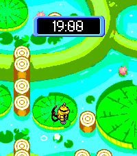

<!-- Generated by scripts/update_app_directory.py: do not edit by hand -->
[← All Pebble Developers](../developers.md)

# chc4

*1 watchface · Last updated 2026-10-11 · [About these lists](../about-app-lists.md)*

Links: [Pebble App Store](https://apps.repebble.com/apps/dev/chc4_17896860c21e789f1c14004b) · [GitHub (chc4)](https://github.com/chc4)

<h2 class="app-name" id="app-9b477c7754894b6ca9d1854a"><a href="https://apps.repebble.com/9b477c7754894b6ca9d1854a">PMD Friend Areas</a> v1.2.0</h2>
<a class="app-source" href="https://github.com/chc4/PebbleFriendArea" title="Source code" data-search-exclude>View source</a>

Watchface

Released 2026-08-21 Updated 2026-10-05

Runs on: Time 2

Displays a random Friend Area from Pokemon Mystery Dungeon, including a random Pokemon that wanders around in response to shakes. The background will cycle every 6 hours, but can be manually…

