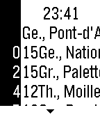

<!-- Generated by scripts/update_app_directory.py: do not edit by hand -->
[← All Pebble Developers](../developers.md)

# Cheese

*2 apps · Last updated 2026-10-11 · [About these lists](../about-app-lists.md)*

Links: [Pebble App Store](https://apps.repebble.com/apps/dev/cheese_567c7a046646d2de810000d6) · [GitHub (cheesenoc)](https://github.com/cheesenoc)

<button type="button" data-filter="all" aria-pressed="true">All 2</button><button type="button" data-filter="watchface" aria-pressed="false" disabled>Watchfaces 0</button><button type="button" data-filter="watchapp" aria-pressed="false">Apps 2</button>

<label class="dev-sort">Sort by <select><option value="updated">Recently updated</option><option value="released">Newest release</option><option value="title">A–Z</option></select></label>

<h2 class="app-name" id="app-576ff6e8ba2fe50eb000018a"><a href="https://apps.repebble.com/576ff6e8ba2fe50eb000018a">aare</a> v1.0</h2>
<a class="app-source" href="https://github.com/cheesenoc/aare" title="Source code" data-search-exclude>View source</a>

App

Released 2016-06-26 Updated 2016-06-26

Runs on: Round 2, Time 2, Pebble 2 Duo, Pebble 2, Time Round, Time, Classic

Simply displays the current water temperature of Switzerland’s most beautiful river. Uses data from BAFU via aare.schwumm.ch.

<h2 class="app-name" id="app-56b738ac0d7f3910c4000011"><a href="https://apps.repebble.com/56b738ac0d7f3910c4000011">Tramlin</a> v1.3</h2>
<a class="app-source" href="https://github.com/cheesenoc/tramlin" title="Source code" data-search-exclude>View source</a>

App

Released 2016-02-07 Updated 2016-05-08

Runs on: Round 2, Time 2, Pebble 2 Duo, Pebble 2, Time Round, Time, Classic

Tramlin is a rudimentary Pebble-port of Wemlin, the successful Swiss public transport app. For the closest 10 stops, it shows you the next 10 departures of the various lines at those stops…

