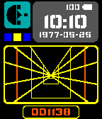
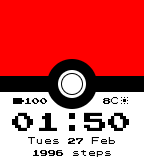

<!-- Generated by scripts/update_app_directory.py: do not edit by hand -->
[← All Pebble Developers](../developers.md)

# cheeseisdisgusting

*2 watchfaces and 2 apps · Last updated 2026-10-11 · [About these lists](../about-app-lists.md)*

Links: [Pebble App Store](https://apps.repebble.com/apps/dev/cheeseisdisgusting_55fcc1f028dd98074e000037) · [Rebble App Store](https://apps.rebble.io/en_US/developer/55fcc1f028dd98074e000037/1) · [GitHub (cheeseisdisgusting)](https://github.com/cheeseisdisgusting) · [Website (goo.gl)](https://goo.gl/7JTQ7A)

<button type="button" data-filter="all" aria-pressed="true">All 4</button><button type="button" data-filter="watchface" aria-pressed="false">Watchfaces 2</button><button type="button" data-filter="watchapp" aria-pressed="false">Apps 2</button>

<label class="dev-sort">Sort by <select><option value="updated">Recently updated</option><option value="released">Newest release</option><option value="title">A–Z</option></select></label>

<h2 class="app-name" id="app-57604008837089081e0000e7"><a href="https://apps.repebble.com/57604008837089081e0000e7">CB Schedule</a> v0.54</h2>
<a class="app-source" href="https://github.com/cheeseisdisgusting/cbschedule" title="Source code" data-search-exclude>View source</a>

App

Released 2016-06-14 Updated 2019-07-24

Runs on: Round 2, Time 2, Pebble 2 Duo, Pebble 2, Time Round, Time, Classic

NEVER FORGET WHAT CLASS IT IS! (At least if you go to Colonel By.) With CB Schedule, you&#x27;ll be able to: - See the current day and what your next class is with a few clicks of a button! - See your…

<h2 class="app-name" id="app-591bbf476ca3872934000ce5"><a href="https://apps.rebble.io/en_US/application/591bbf476ca3872934000ce5">Star Wars Targeting Computer</a> v1.8</h2>
<a class="app-source" href="https://goo.gl/xcPJdi" title="Source code" data-search-exclude>View source</a>

Watchface

Released 2017-05-17 Updated 2018-05-05 Rebble App Store

Runs on: Round 2, Time 2, Pebble 2 Duo, Pebble 2, Time Round, Time, Classic

It&#x27;s no good, I can&#x27;t maneuver! At least with this watchface, you&#x27;ll be able to tell the time. Featuring the Star Wars Targeting Computer, this watchface includes the time, date, step count (at…

<h2 class="app-name" id="app-59f673bd461a8d8cae00060a"><a href="https://apps.rebble.io/en_US/application/59f673bd461a8d8cae00060a">Poké Ball</a> v1.3</h2>
<a class="app-source" href="https://github.com/cheeseisdisgusting/poke-ball-watchface" title="Source code" data-search-exclude>View source</a>

Watchface

Released 2017-10-30 Updated 2018-05-05 Rebble App Store

Runs on: Round 2, Time 2, Time Round, Time

Gotta catch &#x27;em all! With this watchface, you&#x27;re sure to become the Poké Master in no time - flick your wrist and switch between any of the 27 canonical Poké Balls. View weather, steps, date, and…

<h2 class="app-name" id="app-583dc06f00355abe66000862"><a href="https://apps.repebble.com/583dc06f00355abe66000862">Breathe</a> v1.0</h2>
<a class="app-source" href="https://goo.gl/czYlUe" title="Source code" data-search-exclude>View source</a>

App

Released 2016-11-29 Updated 2018-05-05

Runs on: Round 2, Time 2, Pebble 2 Duo, Pebble 2, Time Round, Time, Classic

Take a moment to breathe. In the hectic life that we have now, take a step back and take a moment to collect our thoughts. Features ‣ A soothing circle animation with gentle pulses to indicate…

