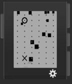

<!-- Generated by scripts/update_app_directory.py: do not edit by hand -->
[← All Pebble Developers](../developers.md)

# Chen =L

*1 watchface · Last updated 2026-10-11 · [About these lists](../about-app-lists.md)*

Links: [Pebble App Store](https://apps.repebble.com/apps/dev/chen-l_54b75febcba6361989000020) · [GitHub (chenlianMT)](https://github.com/chenlianMT) · [Website (liangchen1ce.github.io)](http://liangchen1ce.github.io)

<h2 class="app-name" id="app-54d9c75763eb41ed77000067"><a href="https://apps.repebble.com/54d9c75763eb41ed77000067">Collision Clock</a> v1.0</h2>
<a class="app-source" href="https://github.com/chenlianMT/Pebble_WatchFace" title="Source code" data-search-exclude>View source</a>

Watchface

Released 2015-02-10 Updated 2015-02-10

Runs on: Time 2, Pebble 2 Duo, Pebble 2, Time, Classic

Guess what corresponds to hour, minute, and second?

