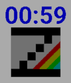

<!-- Generated by scripts/update_app_directory.py: do not edit by hand -->
[← All Pebble Developers](../developers.md)

# chernandezba

*1 watchface · Last updated 2026-10-11 · [About these lists](../about-app-lists.md)*

Links: [Rebble App Store](https://apps.rebble.io/en_US/developer/52f00e048f27d1d3940000ce/1) · [GitHub (chernandezba)](https://github.com/chernandezba)

<h2 class="app-name" id="app-692644f5703cec0009a280fd"><a href="https://apps.rebble.io/en_US/application/692644f5703cec0009a280fd">ZEsarUX emulator watchface</a> v1.7.1</h2>
<a class="app-source" href="https://github.com/chernandezba/zesarux-pebble-watchface" title="Source code" data-search-exclude>View source</a>

Watchface · <a href="https://forum.rebble.io/t/230" title="Discuss this app on the Rebble forum" data-search-exclude>Forum thread</a>

Released 2025-11-26 Updated 2026-06-03 Rebble App Store

Runs on: Round 2, Time 2, Pebble 2 Duo, Pebble 2, Time Round, Time, Classic

Simple ZEsarUX emulator watchface Color stripes can be animated every minute, chosen on settings. When tapping Pebble, the number of ZEsarUX yesterday users will be shown

