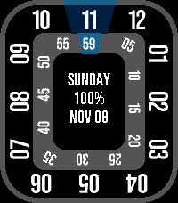
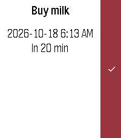

<!-- Generated by scripts/update_app_directory.py: do not edit by hand -->
[← All Pebble Developers](../developers.md)

# chidmdxx

*1 watchface and 1 app · Last updated 2026-10-26 · [About these lists](../about-app-lists.md)*

Links: [Pebble App Store](https://apps.repebble.com/apps/dev/chidmdxx_94b7254609f3a9466db7ef6d) · [GitHub (chidmdxx)](https://github.com/chidmdxx)

<button type="button" data-filter="all" aria-pressed="true">All 2</button><button type="button" data-filter="watchface" aria-pressed="false">Watchfaces 1</button><button type="button" data-filter="watchapp" aria-pressed="false">Apps 1</button>

<label class="dev-sort">Sort by <select><option value="updated">Recently updated</option><option value="released">Newest release</option><option value="title">A–Z</option></select></label>

<h2 class="app-name" id="app-4f0a548f1808468f8e1051d9"><a href="https://apps.repebble.com/4f0a548f1808468f8e1051d9">Roto360 reimaged</a> v1.2.1</h2>
<a class="app-source" href="https://github.com/chidmdxx/Pebble-Roto360ReImaged" title="Source code" data-search-exclude>View source</a>

Watchface

Apache-2.0 Released 2026-10-20 Updated 2026-10-24

Runs on: Round 2, Time 2, Time Round, Time

Independent remake inspired by Roto360 by MicroByte, love the original, but the scaling on the Round 2 didn&#x27;t make it look good. Step ring is calculated on the 11π/6 arc

<h2 class="app-name" id="app-d39cf7318c2543eb85482e58"><a href="https://apps.repebble.com/d39cf7318c2543eb85482e58">Quick Reminders</a> v1.0.1</h2>
<a class="app-source" href="https://github.com/chidmdxx/Pebble-QuickReminders" title="Source code" data-search-exclude>View source</a>

App

No licence Released 2026-10-15 Updated 2026-10-24

Runs on: Round 2, Time 2, Pebble 2 Duo, Pebble 2, Time Round, Time

A quick Timeline reminder app with a simple dictation-based design, using Pebble’s voice-to-text. It keeps your reminders in the Timeline, with no separate reminder service. If you leave out the…

